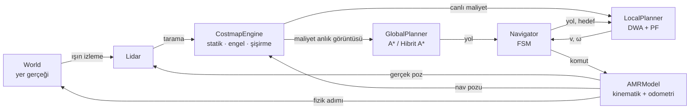
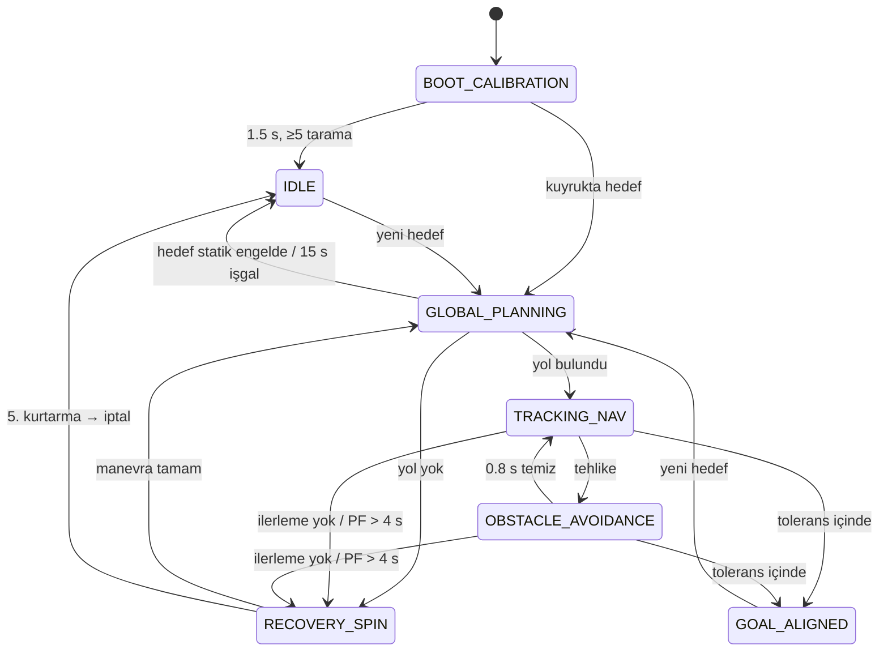

# AMR Dijital İkiz ve Seyrüsefer Yer Kontrol İstasyonu (GCS)

Otonom mobil robot (AMR) için tarayıcıda çalışan, tek dosyalık bir seyrüsefer simülasyonu ve yer kontrol istasyonu arayüzü. Mimari, ROS 2 Nav2 yığınının bileşen ayrımı örnek alınarak kurulmuştur:

- harita katmanları,
- küresel planlayıcı,
- yerel kontrolcü,
- davranış durum makinesi.

Sistem; kinematik, sensör, maliyet haritası, planlama ve görev yönetimi katmanlarının birlikte çalışmasını görsel ve sayısal olarak incelemek için tasarlanmıştır.

| | |
|---|---|
| **Dosya** | `index.html` (1903 satır, ~120 KB) |
| **Teknoloji** | HTML5 Canvas 2D, CSS3, Vanilla JavaScript (ES2017+) |
| **Bağımlılık** | Yok. CDN, paket yöneticisi, derleme adımı ve sunucu gerekmez. |
| **Arayüz dili** | Türkçe |
| **Birimler** | SI: metre, radyan, saniye |

---

## İçindekiler

1. [Hızlı başlangıç](#1-hızlı-başlangıç)
2. [Özellikler](#2-özellikler)
3. [Kullanım](#3-kullanım)
4. [Mimari](#4-mimari)
5. [Alt sistemler ve matematiksel model](#5-alt-sistemler-ve-matematiksel-model)
6. [Görev durum makinesi](#6-görev-durum-makinesi)
7. [Zamanlama ve determinizm](#7-zamanlama-ve-determinizm)
8. [Parametreler](#8-parametreler)
9. [Kaynak kod yapısı](#9-kaynak-kod-yapısı)
10. [Test ve doğrulama](#10-test-ve-doğrulama)
11. [Bilinen sınırlamalar](#11-bilinen-sınırlamalar)
12. [Geliştirme notları](#12-geliştirme-notları)
13. [Nav2 karşılık tablosu](#13-nav2-karşılık-tablosu)
14. [Kaynakça](#14-kaynakça)

---

## 1. Hızlı başlangıç

1. `index.html` dosyasını indirin.
2. Dosyayı Chrome, Edge veya Firefox ile açın. Çift tıklamak yeterlidir; internet bağlantısı gerekmez.
3. Açılışta şunlar gerçekleşir:
   - 1.5 s süren `BOOT_CALIBRATION` aşaması.
   - Ardından bir demo görevi kendiliğinden başlar. Robot (1.6, 1.6) noktasından hedef poza (21.3, 4.5, −90°) gider.

Yerel bir sunucu üzerinden de servis edilebilir; davranış değişmez:

```bash
python3 -m http.server 8000
# tarayıcıda: http://localhost:8000/index.html
```

---

## 2. Özellikler

### Kinematik ve dinamik
- **Diferansiyel sürüş** ve **üçteker/bisiklet** kinematiği. Çalışma sırasında aralarında geçiş yapılabilir.
- Açık dinamik sınırlar:
  - hızlanma `a_max`,
  - frenleme yavaşlaması `a_fren`,
  - açısal ivme `α_max`,
  - direksiyon hızı `δ̇_max`,
  - teker hızı doyumu,
  - acil durdurma yavaşlaması.
- **Enkoder odometrisi.** Sıfır ortalamalı Gauss gürültüsü uygulanır ve varyans kat edilen mesafeyle doğrusal büyür. Odometri gerçek pozdan bağımsız olarak kayar.

### Algılama ve harita
- **2B LIDAR:**
  - 360° tarama, 180–720 ışın.
  - Menzil sınırları, Gauss mesafe gürültüsü, stokastik veri kaybı.
  - Amanatides–Woo ızgara DDA ile ışın izleme ve dinamik engeller için analitik ışın–daire kesişimi.
- **Çok katmanlı maliyet haritası** (0.10 m çözünürlük, 260 × 160 hücre):
  - **Statik katman:** sınır duvarları ve bilinen engeller.
  - **Engel katmanı:** log-odds doluluk modeli; Bresenham ışın temizleme ve LIDAR isabetleriyle işaretleme.
  - **Şişirme katmanı:** içsel yarıçap ve `ζ` faktörüyle üstel maliyet sönümü (Nav2 `inflation_layer` fonksiyonu).

### Planlama
- **Küresel planlayıcı:**
  - 8-bağlantılı maliyet-ağırlıklı ızgara A* ve gradyan düzgünleştirici.
  - Dubins analitik genişletmeli **hibrit A***.
  - Asenkron ve dilimli çalışır: arama kare başına sınırlı iş yapar, robot bu sırada eski yolu izlemeye devam eder.
- **Yerel planlayıcı:**
  - N adımlı ileri açılım yapan dinamik pencere yaklaşımı (DWA).
  - Kabul edilebilir yörünge kalmadığında yapay potansiyel alana geri çekilir.

### Görev yönetimi
- Yedi durumlu sonlu durum makinesi:
  - kalibrasyon,
  - bekleme,
  - planlama,
  - izleme,
  - engelden kaçınma,
  - kurtarma,
  - hedefte hizalanma.
- Kurtarma davranışları: yerel engel katmanı temizleme, yerinde dönüş (diferansiyel) veya geri manevra (üçteker).

### Arayüz
- Karanlık telemetri teması: OLED siyahı, fosfor yeşili, kehribar, camgöbeği.
- Metrik ızgaralı görünüm alanı; yakınlaştırma ve kaydırma desteği.
- Yedi açılıp kapatılabilir görsel katman.
- Telemetri paneli:
  - kinematik değerler ve modül başına hesaplama süreleri,
  - LIDAR radarı,
  - hız geçmişi grafiği,
  - zaman damgalı tanı günlüğü.
- Gerçek zamanlı FSM durum grafiği.

---

## 3. Kullanım

### Fare

| Eylem | İşlev |
|---|---|
| Sol tık / sol sürükleme | Seçili aracı uygular |
| Sağ veya orta tuşla sürükleme | Haritayı kaydırır |
| Tekerlek | İmleç etrafında yakınlaştırır / uzaklaştırır |
| İmleç üzerinde bekletme | Sağ üstte `x`, `y`, maliyet değeri ve açıklık gösterilir |

### Araçlar

| Araç | Kısayol | Davranış |
|---|---|---|
| **Hedef** | `1` | Tıkla-bırak: hedef konum (yön, robottan hedefe doğru alınır). Tıkla-sürükle: sürükleme yönü hedefteki son yön `θ_g` olur. |
| **Statik Duvar** | `2` | Sürükleyerek 0.2 m kalınlıkta duvar çizer. Duvar hem yer gerçeğine hem statik katmana eklenir. Robot ayak izinin üzerine çizilmez. |
| **Dinamik Hedef** | `3` | Tıklanan noktaya gezgin bir engel ekler. Robot bu engeli yalnızca LIDAR ile algılar. |
| **Silgi** | `4` | 0.4 m yarıçapta duvar, dinamik engel ve log-odds izlerini siler. Dış sınır duvarları silinmez. |

### Simülasyon kontrolleri

| Kontrol | Kısayol | İşlev |
|---|---|---|
| Duraklat / Devam | `Boşluk` | Simülasyon zamanını durdurur veya sürdürür |
| Adım | `.` | Simülasyonu 50 ms (bir kontrol periyodu) ilerletir |
| Sıfırla | — | Tohum kutusundaki değerle dünyayı yeniden kurar |
| Sığdır | `F` | Görünümü haritaya sığdırır |
| Zaman ölçeği | — | ×0.25, ×0.5, ×1, ×2, ×4 |
| Acil durdurma | `E` | 4.0 m/s² ile durdurur ve komutları kilitler. Tekrar basıldığında serbest bırakır ve yeniden plan yapar. |
| Engel katmanını temizle | — | Tüm log-odds durumunu sıfırlar |

### Model seçimleri

| Seçim | Seçenekler |
|---|---|
| Kinematik | Diferansiyel · Üçteker/Bisiklet |
| Küresel planlayıcı | Otomatik (diferansiyel → ızgara A*, üçteker → hibrit A*) · Izgara A* · Hibrit A* |
| Navigasyon pozu | Yer gerçeği (ideal lokalizasyon varsayımı) · Ham odometri |

"Ham odometri" seçildiğinde şunlar robotun kendi kayan poz tahminine göre yapılır:

- LIDAR verisinin haritaya izdüşümü,
- planlama,
- kontrol.

Kayma, haritadaki engellerin kaymasına ve hedefe yanlış konumda varılmasına yol açar. Turuncu kesikli "odometri hayaleti", tahmini pozu gösterir.

### Görsel öğeler

| Öğe | Anlamı |
|---|---|
| Açık yeşil kenarlı bloklar | Duvarlar |
| Kırmızı hücreler | Engel katmanındaki ölümcül hücreler (LIDAR ile bulunan) |
| Mor bant | İçsel bölge: robot merkezinin giremeyeceği alan (maliyet 253) |
| Camgöbeği → turuncu geçiş | Şişirme maliyeti (engele yaklaştıkça artar) |
| Camgöbeği çizgi | Küresel yol (önü tıkalıysa turuncu) |
| Turuncu daire | DWA havuç (lookahead) noktası |
| Turuncu kalın çizgi | DWA'nın seçtiği yörünge |
| Yeşil tonlu ince çizgiler | Kabul edilebilir yörüngeler (koyuluk puanla artar) |
| Kırmızı ince çizgiler | `V_a` tarafından reddedilen yörüngeler |
| Mor daireler | Dinamik engeller ve hız vektörleri |
| Turuncu kesikli daire | Odometri hayaleti |

### Telemetri paneli

- **Kinematik:**
  - `v`, `ω`, `v̇`,
  - teker hızları (diferansiyel) veya direksiyon açısı (üçteker),
  - gerçek ve odometri pozu, odometri hatası,
  - kat edilen yol, kontrol modu, son plan,
  - engel hücresi sayısı, temas sayısı.
- **Hesaplama bütçesi:**
  - küresel plan (toplam süre, dilim sayısı, en uzun dilim),
  - DWA döngüsü, ışın izleme, maliyet haritası güncellemesi,
  - simülasyon adımları, çizim, kare toplamı, FPS.
  - Çubuk renkleri: 8 ms üzeri kehribar, 16.7 ms üzeri kırmızı.
- **LIDAR radarı:** robot merkezli, ileri yön yukarıda. 1 m altı isabetler kırmızı, 2.5 m altı isabetler kehribar renktedir.
- **Hız geçmişi:** son 15 s'lik `v` ve `ω` grafiği.
- **Tanı günlüğü:**
  - Her satır `[T+saniye]` biçiminde simülasyon zamanı damgası taşır.
  - Seviyeler: `INFO`, `WARN`, `CRIT`.
  - Aynı mesaj 2 s içinde tekrarlanırsa `×n` sayacıyla birleştirilir.

---

## 4. Mimari



Simülasyon çekirdeği (bölüm 0–10) DOM'a erişmez. Arayüz katmanı (bölüm 11–14) çekirdeği yalnızca okur ve operatör girdilerini çekirdeğin genel yöntemleri üzerinden iletir. Bu ayrım sayesinde çekirdek Node.js'te arayüzsüz çalıştırılabilir (bkz. [Test ve doğrulama](#10-test-ve-doğrulama)).

---

## 5. Alt sistemler ve matematiksel model

Aşağıdaki formüllerin tamamı kaynak kodda ilgili sınıfın yorum satırlarında da belgelenmiştir.

### 5.1 `AMRModel` — kinematik, dinamik, odometri

**Tekteker kinematiği:**

$$
\begin{bmatrix}\dot x\\ \dot y\\ \dot\theta\end{bmatrix} =
\begin{bmatrix}\cos\theta & 0\\ \sin\theta & 0\\ 0 & 1\end{bmatrix}
\begin{bmatrix}v\\ \omega\end{bmatrix}
$$

**Diferansiyel ters kinematik:**

$$
\begin{bmatrix}v_R\\ v_L\end{bmatrix} =
\begin{bmatrix}1 & L/2\\ 1 & -L/2\end{bmatrix}
\begin{bmatrix}v\\ \omega\end{bmatrix}
$$

Teker hızı doyuma ulaştığında `(v, ω)` orantılı ölçeklenir; böylece eğrilik korunur.

**Bisiklet/üçteker modeli** (referans: arka aks orta noktası):

$$\dot\theta = \frac{v\tan\delta}{L_{wb}}, \qquad v_f = \frac{v}{\cos\delta}$$

- İstenen direksiyon açısı `δ = atan(ω·L_wb / v)` ile hesaplanır.
- `|δ| ≤ δ_max` ve `|δ̇| ≤ δ̇_max` sınırları uygulanır.
- Minimum dönüş yarıçapı `ρ_min = L_wb / tan δ_max ≈ 0.42 m`.

**Poz entegrasyonu** (tam yay, ω ≠ 0):

$$x' = x + \frac{v}{\omega}\big(\sin(\theta+\omega\Delta t)-\sin\theta\big), \quad y' = y - \frac{v}{\omega}\big(\cos(\theta+\omega\Delta t)-\cos\theta\big)$$

**Dinamik sınırlar:**
- Hız hedefe doğru rampalanır.
- Mutlak hız artarken `a_max`, azalırken `a_fren`, acil durdurmada `a_acil` kullanılır.
- Açısal hız `α_max` ile sınırlanır.

**Temas modeli:**
- Ayak izi (yarıçap − 0.02 m) ile duvarlar ve dinamik engeller arasındaki penetrasyon derinliği hesaplanır.
- Penetrasyonu artıran hareket reddedilir ve robot sert durur.
- Penetrasyonu azaltan hareket serbesttir. Bu sayede temastan çıkış mümkündür.

**Enkoder odometrisi:**

$$\Delta s_{\text{ölç}} = \Delta s + \varepsilon,\qquad \varepsilon\sim\mathcal N\!\left(0,\ \sigma^2\,|\Delta s|\right)$$

Varyans kat edilen mesafeyle doğrusal büyür; bu nedenle konum ve yön hatası rastgele yürüyüş biçiminde birikir.

- **Diferansiyel:** `Δs = (Δs_R + Δs_L)/2`, `Δθ = (Δs_R − Δs_L)/L`.
- **Üçteker:** `Δs = Δs_f·cos δ̂`, `Δθ = Δs_f·sin δ̂ / L_wb`, `δ̂ = δ + N(0, σ_δ²)`.
- Entegrasyon orta nokta yöntemiyle yapılır: `x += Δs·cos(θ + Δθ/2)`.

### 5.2 `Lidar`

- Işınlar robot merkezinden, gerçek pozdan atılır.
- Her ışın için ölçüm modeli:
  - `r̂ = r + N(0, σ_r²)`,
  - `p_kayıp` olasılıkla veri kaybı,
  - `r̂ < r_min` ise ölçüm geçersiz.
- Işın bayrakları:
  - `0` — kayıp veya geçersiz. Temizleme yapılmaz.
  - `1` — isabet.
  - `2` — menzilde dönüş yok. Menzil sonuna kadar temizleme yapılır.
- Duvar kesişimi: Amanatides–Woo DDA. Hücre başına O(1), ışın başına O(r/çözünürlük).
- Dinamik engel kesişimi: `t = b − √(b² − c)`. Yalnızca menzil içindeki engeller ön-filtrelenir.

### 5.3 `CostmapEngine` — çok katmanlı maliyet haritası

**Log-odds doluluk güncellemesi:**

$$L(m_i\mid z_{1:t}) = L(m_i\mid z_{1:t-1}) + \log\frac{P(m_i\mid z_t)}{1-P(m_i\mid z_t)} - L_0,\qquad L_0=\operatorname{logit}(0.5)=0$$

| Parametre | Değer |
|---|---|
| `P(dolu)` | 0.70 → +0.847 |
| `P(boş)` | 0.40 → −0.405 |
| Kırpma aralığı | [−2.0, 3.5] |
| Ölümcül eşiği `L > 1.2` | Ardışık en az iki isabet gerektirir; tekil gürültü isabetini filtreler |

Işın üzerindeki hücreler Bresenham algoritmasıyla temizlenir. İzdüşüm, seyrüsefer pozuna göre yapılır.

**Şişirme fonksiyonu** (Nav2 `inflation_layer`):

$$\text{maliyet}(d)=
\begin{cases}
254 & d = 0\ \text{(ölümcül)}\\
253 & d \le r_{\text{içsel}}\\
\lfloor 252\cdot e^{-\zeta(d-r_{\text{içsel}})}\rfloor & r_{\text{içsel}} < d \le r_{\text{şiş}}\\
0 & d > r_{\text{şiş}}
\end{cases}$$

Şartnamedeki `Maliyet_ölümcül` katsayısı, Nav2'deki gibi `INSCRIBED − 1 = 252` olarak uygulanmıştır. 253 ve 254 ayrık sınıflardır.

**Verimli şişirme:**
- Önceden hesaplanmış bir çekirdek (ofset + maliyet) yalnızca **kenar** ölümcül hücrelerden damgalanır. Kenar hücre, en az bir 4-komşusu ölümcül olmayan hücredir.
- Serbest bir hücreye en yakın engel hücresi her zaman bir kenar hücresi olduğundan sonuç değişmez; iç hücreler atlanır.
- Statik katmanın şişirmesi önbelleğe alınır ve yalnızca harita veya parametre değiştiğinde yeniden hesaplanır.
- Birleşik harita: `master = max(statik_şişirme, engel ∪ engel_şişirme)`.

**Ters dönüşüm** (DWA açıklık terimi için):

$$d - r_{\text{içsel}} = -\frac{\ln(c/252)}{\zeta}$$

### 5.4 `GlobalPlanner` — küresel planlayıcı

**Izgara A\*:**
- 8-bağlantılı arama.
- Kenar maliyeti: `ℓ·res·(1 + w_c·c/252)`, `w_c = 8`.
- Sezgisel: oktil mesafe. Kenar çarpanı ≥ 1 olduğundan kabul edilebilirdir.
- Köşe kesme yasaktır: çapraz adımda ortogonal komşulardan biri ölümcülse adım atılmaz.
- İçsel (253) hücreler yalnızca başlangıca `r + 0.3 m` mesafede geçilebilir. Bu, engele yakın başlangıçlarda kaçış imkânı verir.
- Arama sonrası gradyan düzgünleştirici uygulanır: `p_i ← p_i + w_d(o_i − p_i) + w_s(p_{i−1} + p_{i+1} − 2p_i)`. Adım şu durumlarda reddedilir:
  - nokta içsel bölgeye giriyorsa,
  - maliyet orijinale göre 40'tan fazla artıyorsa.

**Hibrit A\*** (Dolgov ve ark., yalnızca ileri yön):
- Durum: sürekli `(x, y, θ)`. Kafes: 0.2 m × 0.2 m × 5° (72 yön kutusu). Her kutu için en iyi düğüm tutulur.
- Hareket ilkelleri:
  - Eğrilikler: `κ ∈ {−κ_max, −κ_max/2, 0, κ_max/2, κ_max}`.
  - Yay uzunluğu 0.3 m; çarpışma kontrolü 0.1 m aralıklarla yapılır.
- Sezgisel: `h = max(h_Dijkstra, L_Dubins)`.
  - `h_Dijkstra` engelleri hesaba katar, holonomiktir.
  - `L_Dubins` engelsizdir, holonomik değildir.
- Analitik genişletme:
  - Hedefe 5 m'den yakınken her 4 genişletmede bir Dubins atışı denenir.
  - 1.5 m'den yakınken her genişletmede denenir.
- 8000 genişletmede sonuç çıkmazsa ızgara A*'a düşülür ve durum günlüğe yazılır.

**Dubins eğrileri:**
- Shkel–Lumelsky normalleştirilmiş çözümü kullanılır: LSL, LSR, RSL, RSR, RLR, LRL.
- Uç nokta doğruluğu testle ölçülmüştür: 2000 rastgele çiftte en büyük hata 1.3 × 10⁻¹⁴.

**Asenkron ve dilimli yürütme:**
- `begin()` maliyet haritasının anlık görüntüsünü alır ve bir JavaScript üreteci (generator) başlatır.
- `step()` her kontrol döngüsünde bir dilim ilerletir. Dilim büyüklüğü:
  - ızgara A* / Dijkstra: 10 000 yığın çekimi,
  - hibrit A*: 300 genişletme.
- Dilim sınırları süreye değil iterasyon sayısına bağlıdır; bu nedenle sonuç deterministiktir.
- Robot, yeniden planlama sürerken eski yolu izlemeye devam eder.

### 5.5 `LocalPlanner` — DWA ve potansiyel alan

**Pencere:**

- `V_s = {v ∈ [0, v_max], ω ∈ [−ω_max, ω_max]}`
- `V_d = {v ∈ [v_c − a_fren·Δt, v_c + a_max·Δt], ω ∈ [ω_c − α_max·Δt, ω_c + α_max·Δt]}`, `Δt = 1/f_kontrol`
- `V_a = {(v,ω) | v²/(2·a_fren) + 0.06 < d_çarpışma(v,ω)}`
- `V_r = V_s ∩ V_d ∩ V_a`

**Örnekleme:**
- Diferansiyel: `9 × 19` adet `(v, ω)` örneği.
- Üçteker: `9 × 19` adet `(v, δ_hedef)` örneği. `δ_hedef` tüm `±δ_max` aralığında örneklenir; direksiyonun `δ̇_max` ile hedefe rampalanması açılım içinde simüle edilir. Böylece `V_d` örtük olarak sağlanır.
- Hedefe yaklaşırken `v ≤ max(0.06, √(a_fren·d_hedef))` sınırı uygulanır.

**Açılım:** ufuk `T` (varsayılan 2 s), adım `0.1 s`. Maliyet ≥ 253 olduğunda çarpışma mesafesi kaydedilir. Havuç noktası hedefse açılım hedef mesafesinde kesilir.

**Amaç fonksiyonu:**

$$G(v,\omega)=\alpha\cdot\text{heading}+\beta\cdot\text{dist}+\gamma\cdot\text{velocity}+\delta\cdot\text{progress}$$

| Terim | Tanım |
|---|---|
| heading | `1 − |∠(uç nokta → havuç) − θ_uç| / π` |
| dist | `min(1, min açıklık / d_güv)`, `d_güv = min(r_şiş − r_içsel, 0.08 m)` |
| velocity | `v / v_max` |
| progress | `clamp((|c − p₀| − |c − p_uç|) / (v_max·T), 0, 1)` |

- Havuç ileri bakış mesafesi hıza bağlıdır: `L(v) = max(0.5, v·T + 0.4)`. Bu, uç noktanın havucu aşıp yön teriminin tersine dönmesini önler.

> **Klasik formülden sapma.** Fox–Burgard–Thrun `G(v,ω)` formülü üç terimlidir. `progress` terimi bilinçli olarak eklenmiştir ve şartnamedeki "ilerleme" ölçütüne karşılık gelir.
>
> Gerekçe: Yalnız üç terimle, kapı geçişleri gibi dar yerlerde ileri yörüngelerin açıklığı birkaç santimetre azaldığı için `v = 0` (yerinde bekleme) en yüksek puanı alabiliyordu. Bu klasik DWA yerel minimumu testlerde robotun durmasına yol açtı. `progress` terimi beklemeye 0 puan verir.
>
> Aynı nedenle `dist` terimi 0.08 m'de doyurulmuştur. `δ = 0` ayarlanarak üç terimli davranışa dönülebilir.

**Dönüş şimi** (yalnız diferansiyel): Havuca yön hatası > 0.9 rad ise DWA atlanır ve yerinde dönülür (Nav2 `RotationShimController` karşılığı).

**Potansiyel alan geri çekilmesi** (`V_r = ∅` olduğunda):

$$\mathbf F = \hat{\mathbf e}(\mathbf c-\mathbf p) + \sum_i k_r\Big(\frac1{d_i}-\frac1{d_0}\Big)\frac{1}{d_i^2}\,\hat{\mathbf e}(\mathbf p-\mathbf o_i),\qquad d_i<d_0=1.2\text{ m}$$

- `d_i`, ayak izi yüzeyinden ölçülen mesafedir.
- Komut yön hatasından türetilir; hız ön açıklıkla ölçeklenir.
- Ön kapalı, arka açıksa düşük hızla geri gidilir.

---

## 6. Görev durum makinesi



| Durum | Davranış |
|---|---|
| `BOOT_CALIBRATION` | Robot durur. LIDAR taramaları engel katmanını başlatır. Çıkışta enkoder odometrisi gerçek poza sıfırlanır. |
| `IDLE` | Komut sıfır; hedef beklenir. |
| `GLOBAL_PLANNING` | Robot durur; asenkron plan işi yürütülür. Hedef yalnızca dinamik bir engel tarafından işgal edilmişse 15 s boyunca yeniden denenir. |
| `TRACKING_NAV` | DWA ile yol izlenir. Yeniden planlama periyodiktir (ızgara A* için 1 s, hibrit A* için 3 s); yol tıkanırsa 0.5 s içinde yapılır. |
| `OBSTACLE_AVOIDANCE` | Tetikleyiciler: yol önündeki 2.5 m tıkalı, potansiyel alana geçildi veya en düşük açıklık < 0.10 m. Bu durumda DWA'da `β × 1.8` ve `γ × 0.6` uygulanır. |
| `RECOVERY_SPIN` | Robot çevresinde 2.5 m yarıçapta engel katmanı temizlenir. Ardından diferansiyelde π dönüş, üçtekerde 0.35 m geri manevra yapılır. |
| `GOAL_ALIGNED` | Diferansiyel: `ε_xy < 0.15 m` sonrası yerinde dönülerek `ε_θ < 0.06 rad` sağlanır. Üçteker: `ε_xy < 0.25 m`; yön hatası > 0.2 rad ise uyarı verilir. |

**İlerleme izleyicisi.** İlerleme, yol boyunca kalan uzunlukla ölçülür (düz hat mesafesi değil). 8 s içinde ilerleme şu eşiğin altında kalırsa kurtarma başlatılır:

- normalde 0.15 m,
- hedefe 0.6 m'den yakınken 0.03 m.

**Acil durdurma.** Bir durum değil, bir kilittir. Etkinken FSM komut üretmez. Serbest bırakıldığında aktif bir görev varsa yeniden plan yapılır.

---

## 7. Zamanlama ve determinizm

| Döngü | Frekans | Not |
|---|---|---|
| Fizik, kinematik, odometri | 200 Hz | Sabit `Δt = 5 ms` |
| LIDAR + maliyet haritası | 15 Hz | |
| Kontrolcü (FSM + DWA) | 20 Hz | Nav2 `controller_frequency` varsayılanı |
| Küresel yeniden planlama | 1 Hz (ızgara A*), 1/3 Hz (hibrit A*) | Yol tıkanırsa anında; dilimli yürütülür |
| Çizim | `requestAnimationFrame` | Arayüz metinleri 10 Hz'de güncellenir |

- Simülasyon, sabit adımlı bir akümülatörle ilerler.
- Kare başına en fazla 240 fizik adımı işlenir. Bu, "spiral of death" koruması olarak çalışır.
- Stokastik süreçler (LIDAR gürültüsü, veri kaybı, enkoder gürültüsü, dinamik engel davranışı) ayrı tohumlu PRNG akışlarından beslenir. Kullanılan üreteçler: mulberry32 ve Box–Muller.
- `performance.now()` yalnızca gecikme ölçümü için kullanılır ve davranışı etkilemez.

**Tekrarlanabilirlik:**
- Aynı tohum ve aynı simülasyon zamanında verilen aynı girdiler aynı sonucu üretir.
- Fareyle verilen operatör girdileri, gerçek zamanlı kare sınırlarında uygulanır. Bu nedenle elle yapılan oturumlar bit düzeyinde tekrarlanamaz.
- Tam tekrarlanabilir deneyler için çekirdeği programatik olarak sürün (bkz. [§10](#10-test-ve-doğrulama)).

---

## 8. Parametreler

### Arayüz sürgüleri

| Sürgü | Birim | Aralık | Adım | Varsayılan | `CFG` anahtarı |
|---|---|---|---|---|---|
| Maks hız `v_max` | m/s | 0.1 – 1.5 | 0.05 | 0.8 | `robot.vMax` |
| Şişirme yarıçapı | m | 0.4 – 1.5 | 0.05 | 0.75 | `costmap.inflR` |
| Maliyet ölçeklemesi `ζ` | 1/m | 0.5 – 10 | 0.5 | 4.0 | `costmap.zeta` |
| Enkoder gürültüsü `σ` | m/√m | 0 – 0.05 | 0.001 | 0.005 | `robot.encNoise` |
| DWA ufku `T` | s | 0.5 – 4 | 0.1 | 2.0 | `dwa.horizon` |
| DWA `α` (yönelim) | — | 0 – 3 | 0.05 | 1.0 | `dwa.alpha` |
| DWA `β` (açıklık) | — | 0 – 3 | 0.05 | 0.6 | `dwa.beta` |
| DWA `γ` (hız) | — | 0 – 3 | 0.05 | 0.4 | `dwa.gamma` |
| DWA `δ` (ilerleme) | — | 0 – 3 | 0.05 | 0.8 | `dwa.delta` |
| LIDAR ışın sayısı | adet | 180 – 720 | 30 | 360 | `lidar.beams` |
| LIDAR menzili | m | 3 – 15 | 0.5 | 10 | `lidar.rMax` |
| Veri kaybı olasılığı | oran | 0 – 0.3 | 0.01 | 0.02 | `lidar.dropout` |

### Yalnızca kodda ayarlanabilen sabitler

| Grup | Parametre | Değer |
|---|---|---|
| Robot | Ayak izi yarıçapı = `r_içsel` | 0.32 m |
| | İz genişliği `L` | 0.46 m |
| | `ω_max` | 1.6 rad/s |
| | `a_max` / `a_fren` / `a_acil` | 0.8 / 1.6 / 4.0 m/s² |
| | `α_max` | 3.0 rad/s² |
| | Teker hızı doyumu | 1.5 m/s |
| | Üçteker `L_wb` | 0.26 m |
| | `δ_max` / `δ̇_max` | 0.55 rad / 1.8 rad/s |
| | Direksiyon enkoderi `σ_δ` | 0.004 rad |
| LIDAR | `r_min` | 0.12 m |
| | Mesafe gürültüsü `σ_r` | 0.012 m |
| | Frekans | 15 Hz |
| Harita | Boyut / çözünürlük | 26 × 16 m / 0.10 m |
| | `P(dolu)` / `P(boş)` | 0.70 / 0.40 |
| | Log-odds kırpma / eşik | [−2.0, 3.5] / 1.2 |
| Planlayıcı | Maliyet ağırlığı `w_c` | 8.0 |
| | Hibrit A* genişletme sınırı | 8000 |
| | Dilim: ızgara / hibrit | 10 000 / 300 |
| DWA | Frekans / açılım adımı | 20 Hz / 0.1 s |
| | Örnek sayısı `n_v × n_ω` | 9 × 19 |
| Hedef | Konum toleransı (diferansiyel / üçteker) | 0.15 / 0.25 m |
| | Yön toleransı (diferansiyel) | 0.06 rad |

Sürgüyle yapılan değişiklikler sayfa yenilenince kaybolur. Kalıcı değişiklik için `index.html` içindeki `CFG` nesnesini (satır ~177) düzenleyin.

Depo düzeni `World.buildDefault()` içinde, metre cinsinden `this.rect(x0, y0, x1, y1)` çağrılarıyla tanımlanır.

---

## 9. Kaynak kod yapısı

Tüm kaynak kod `index.html` içindedir.

| Satır | Bölüm | Sınıf / fonksiyon |
|---|---|---|
| 7–69 | CSS: tema ve yerleşim | — |
| 70–130 | HTML: paneller, butonlar, canvas öğeleri | — |
| 131–176 | Başlık yorumu: mimari, zamanlama, formüller | — |
| 177–237 | Sabitler, yardımcılar, PRNG, yapılandırma | `CFG`, `RNG`, `wrap`, `mod2pi` |
| 238–267 | İkili minimum yığın | `MinHeap` |
| 268–397 | Yer gerçeği dünyası | `World`, `DynamicAgent` |
| 398–479 | Kinematik, dinamik, odometri | `AMRModel` |
| 480–506 | 2B LIDAR | `Lidar` |
| 507–636 | Çok katmanlı maliyet haritası | `CostmapEngine` |
| 637–679 | Dubins eğrileri | `dubins`, `dubinsSample` |
| 680–930 | Küresel planlayıcı | `GlobalPlanner` |
| 931–1074 | Yerel planlayıcı | `LocalPlanner` |
| 1075–1258 | Görev durum makinesi | `Navigator`, `ST` |
| 1259–1348 | Günlük ve simülasyon | `Logger`, `Ring`, `Simulation` |
| 1349 | **`// @@UI_BEGIN`** — çekirdek / arayüz sınırı | — |
| 1350–1639 | Görünüm alanı: çizim ve fare | `Viewport` |
| 1640–1788 | Telemetri, radar, FSM grafiği | `HUD` |
| 1789–1880 | Operatör paneli bağlantıları | `SLIDERS` |
| 1881–1901 | Ana döngü | `frame()` |

Satır numaraları bu sürüme aittir; kod düzenlendikçe kayar.

---

## 10. Test ve doğrulama

### Çekirdeği Node.js'te çalıştırma

`// @@UI_BEGIN` işaretinden önceki kısım DOM'a erişmediği için doğrudan Node.js'te (≥ 16) çalışır.

```js
// extract-core.js — index.html'den simülasyon çekirdeğini çıkarır
const fs = require('fs');
const html = fs.readFileSync('index.html', 'utf8');
const js = html.slice(html.indexOf('<script>') + 8, html.lastIndexOf('</script>'));
const core = js.split('// @@UI_BEGIN')[0];
fs.writeFileSync('core.js', core + '\nmodule.exports = { CFG, Simulation, Logger, ST };\n');
```

```js
// run.js — demo görevini arayüzsüz çalıştırır
const { CFG, Simulation, Logger, ST } = require('./core.js');
CFG.kind = 'diff'; CFG.seed = 1337;
const sim = new Simulation(new Logger());
while (sim.nav.state !== ST.GOAL && sim.t < 120) sim.step(CFG.phys.dt);
console.log(`durum=${sim.nav.state} t=${sim.t.toFixed(2)} s temas=${sim.collisions}`);
for (const e of sim.logger.entries) console.log(e.t.toFixed(2), e.lvl, e.msg);
```

```bash
node extract-core.js && node run.js
# durum=GOAL_ALIGNED t=35.00 s temas=0
```

Bu yöntemle şunlar programatik olarak yapılabilir:

- farklı tohumlar ve hedef dizileriyle toplu deneyler,
- parametre taramaları,
- regresyon testleri.

### Ölçülen sonuçlar

Testler Node.js 22 ve headless Chrome ile, bu sürüm üzerinde yapılmıştır.

**Görev başarısı** — 2 kinematik × 5 tohum × 6 hedef = 60 görev. Hedef dizisine, aynı raf koridorunda 180° dönüş gerektiren pozlar dahildir.

| Ölçüt | Sonuç |
|---|---|
| Hedefe varış | 60 / 60 |
| Fiziksel temas | 0 (son tur); bir önceki turda 30 görevde 1 olay |

**Demo görevi** (tohum 1337):

| Senaryo | Varış süresi | Son hata | Odometri sapması |
|---|---|---|---|
| Diferansiyel, yer gerçeği pozu | 35.0 s | ε_xy 7.4 cm, ε_θ 0.4° | 0.63 m |
| Üçteker, yer gerçeği pozu | 35.5 s | — | 0.02 m |
| Diferansiyel, ham odometri pozu | 35.6 s | Gerçek konumda ~0.6 m sapma (beklenen davranış) | — |

**Hesaplama süreleri** (Node.js, kontrol döngüsü başına):

| Ölçüt | Diferansiyel | Üçteker |
|---|---|---|
| Plan dilimi p50 | 0.38 ms | 2.6 ms |
| Plan dilimi p99 | 3.7 ms | 5.5 ms |
| Plan dilimi en büyük | 18 ms | 22 ms |
| DWA en büyük | 5.0 ms | 5.3 ms |

**Tarayıcı** (headless Chrome, 1600×920 ve 1280×760):

| Ölçüt | Sonuç |
|---|---|
| FPS | 60 |
| Kare başına CPU (simülasyon + çizim) | 0.9 – 2.7 ms |
| Konsol hatası | Yok |
| Arayüz işlevleri | Tüm araçlar, E-stop, adım, sıfırlama ve kinematik geçişi test edildi |

**Dubins doğruluğu:** 2000 rastgele çiftte uç nokta hatası < 1.3 × 10⁻¹⁴.

---

## 11. Bilinen sınırlamalar

- **Kare bütçesi garanti değildir.** Plan dilimleri p99 değerinde 16 ms'nin çok altındadır. Ancak tekil uç değerler 18–22 ms'ye ulaşmıştır; bunlar büyük olasılıkla JIT derleme veya çöp toplama kaynaklıdır. Eşzamanlı yük altında ara sıra kare kaçırılabilir.
- **Lokalizasyon modellenmemiştir.** AMCL veya benzeri bir düzeltme yoktur. "Yer gerçeği" modu ideal lokalizasyon varsayar. "Ham odometri" modunda hata sınırsız büyür.
- **Üçtekerde son yön hatası yola bağlıdır.** Araç yerinde dönemez. Dar alanlarda 25°'ye varan yön hatası gözlemlenmiştir; bu durumda `WARN` kaydı düşülür.
- **Hibrit A\* yalnızca ileri yönlüdür.** Reeds–Shepp eğrileri ve geri vites ilkelleri yoktur. Arama başarısız olursa üçteker için kinematik olarak uygun olmayabilecek bir ızgara A* yoluna düşülür.
- **DWA, Nav2 DWB'nin sadeleştirilmiş bir sürümüdür.** Kritik eklentileri, yol hizalama ve hedef mesafesi kritikleri ayrı olarak modellenmemiştir.
- **Ayak izi dairesel kabul edilir.** Üçteker gövdesi dikdörtgen çizilse de çarpışma ve maliyet hesapları 0.32 m yarıçaplı daire ile yapılır.
- **Dinamik engellerle temas tamamen dışlanmamıştır.** Engel katmanı en az iki isabetle güncellenir (yaklaşık 130 ms gecikme). Yanal yaklaşan engellerle nadir temas olabilir.
- **Duvar kenarında sensör artefaktları.** Statik duvarlara bitişik hücrelerde gürültü kaynaklı engel işaretleri oluşabilir. Gerçek maliyet haritalarındakine benzer bir davranıştır.
- **Fiziksel model kapsamı.** Harita yalnızca 2B'dir. Robot dinamiğinde kütle, eylemsizlik ve tekerlek kayması yoktur; dinamik, hız ve ivme sınırlarıyla temsil edilir.
- **Ekran.** Arayüz masaüstü ekranlar için tasarlanmıştır. 820 px altında paneller dikey olarak dizilir ancak dokunmatik kullanım hedeflenmemiştir.

---

## 12. Geliştirme notları

### Kodlama kuralları

- Fizik, sensör, harita, planlama ve FSM kodu yalnızca `CFG` ve sınıf durumlarını okur. DOM'a erişim `// @@UI_BEGIN` sonrasına aittir.
- Sıcak döngülerde nesne ayırmadan kaçınılır: tip-dizileri, önceden ayrılmış tamponlar ve epoch-stamp dizileri kullanılır.
- Tüm açılar `wrap()` ile `(−π, π]`, gerektiğinde `mod2pi()` ile `[0, 2π)` aralığına normalleştirilir.
- Yeni stokastik süreç eklerken ayrı bir `RNG` akışı açın. Mevcut akışları paylaşmak, diğer süreçlerin rastgele dizilerini değiştirir.

### Yeni bir harita

`World.buildDefault()` içindeki `rect(...)` çağrılarını değiştirin. Dünya boyutu `CFG.world` ile ayarlanır. Boyut değişirse görünüm alanı kendini otomatik olarak sığdırır.

### Yeni bir DWA terimi

`LocalPlanner.compute()` içinde, `G = ...` satırına terimi ekleyin. Ağırlığını `CFG.dwa` nesnesine, sürgüsünü de `SLIDERS` dizisine ekleyin.

### Yeni bir FSM durumu

1. Durum adını `ST` nesnesine ekleyin.
2. `Navigator.tick()` içine durum davranışını, `onEnter()` içine giriş eylemlerini yazın.
3. Durum grafiğinde görünmesi için `FSM_NODES` (ızgara konumu) ve `FSM_EDGES` (geçişler) tablolarını güncelleyin.

---

## 13. Nav2 karşılık tablosu

| Bu projede | ROS 2 Nav2 karşılığı | Fark |
|---|---|---|
| `CostmapEngine` | `nav2_costmap_2d` (static, obstacle, inflation) | Engel katmanında log-odds kullanılır; Nav2 varsayılanı ikili işaretlemedir |
| `GlobalPlanner` (ızgara A*) | `NavFn` / Smac 2D | Gradyan düzgünleştirici dahil |
| `GlobalPlanner` (hibrit A*) | Smac Hybrid-A* | Yalnızca ileri yön, Dubins |
| Asenkron dilimli planlama | `planner_server` ayrı iş parçacığı | İş parçacığı yerine üreteç dilimleri |
| `LocalPlanner` | DWB controller | Kritik eklenti sistemi yok; 4 sabit terim |
| Dönüş şimi | `RotationShimController` | Eşik 0.9 rad |
| `Navigator` | `bt_navigator` + recoveries | Davranış ağacı yerine sonlu durum makinesi |
| `RECOVERY_SPIN` | ClearCostmap + Spin / BackUp | Tek durumda birleşik |
| Odometri | `diff_drive_controller` / `tricycle_controller` odometrisi | — |

---

## 14. Kaynakça

- D. Fox, W. Burgard, S. Thrun, "The Dynamic Window Approach to Collision Avoidance," *IEEE Robotics & Automation Magazine*, 1997.
- D. Dolgov, S. Thrun, M. Montemerlo, J. Diebel, "Path Planning for Autonomous Vehicles in Unknown Semi-structured Environments," *IJRR*, 2010.
- A. M. Shkel, V. Lumelsky, "Classification of the Dubins set," *Robotics and Autonomous Systems*, 2001.
- J. Amanatides, A. Woo, "A Fast Voxel Traversal Algorithm for Ray Tracing," *Eurographics*, 1987.
- O. Khatib, "Real-Time Obstacle Avoidance for Manipulators and Mobile Robots," *IJRR*, 1986.
- S. Thrun, W. Burgard, D. Fox, *Probabilistic Robotics*, MIT Press, 2005 — log-odds doluluk ızgarası ve odometri hareket modeli.
- S. Macenski ve ark., "The Marathon 2: A Navigation System," *IROS*, 2020 — ROS 2 Nav2 mimarisi.

---
